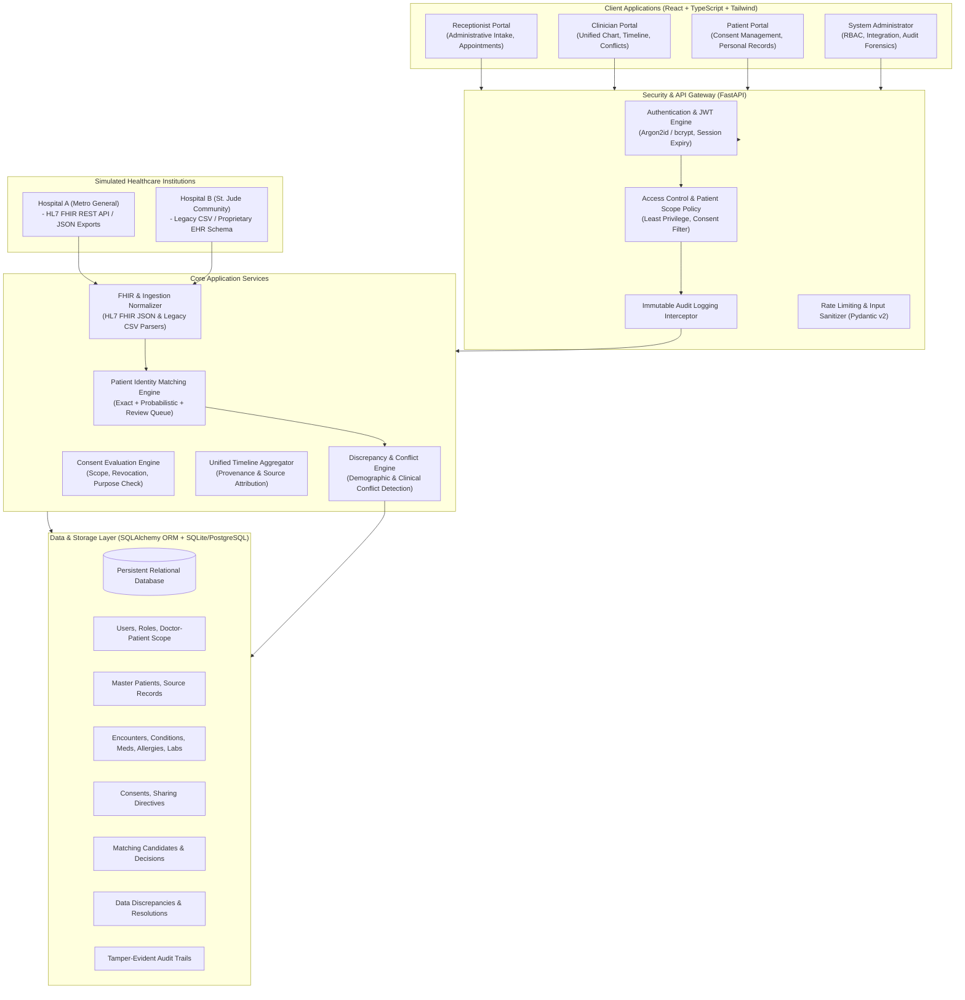
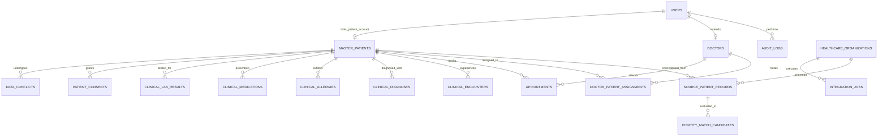

# Stage 1: Planning and Architecture Specification
## Project: Creating a Unified View of a Patient Across Systems

---

## 1. Executive Summary & Objective

In modern healthcare ecosystems, a patient's medical history is fragmented across disparately governed entities: regional hospital networks, ambulatory clinics, diagnostic laboratories, retail pharmacies, and specialized electronic health record (EHR) systems. This fragmentation leads to:
- Adverse drug-drug and drug-allergy interactions due to incomplete medication histories.
- Redundant and costly diagnostic tests.
- Dangerous delays in acute clinical decision-making.
- Patient identity confusion across records.

**"Creating a Unified View of a Patient Across Systems"** is an enterprise-grade, interoperable healthcare software solution designed to ingest, normalize, reconcile, and present cross-institutional medical records in a single, high-fidelity chronological clinical chart.

The system is built on zero-trust healthcare data principles:
- **Strict Role-Based Access Control (RBAC)** and **Patient-Level Authorization Scopes**.
- **Minimum Necessary Access**: Complete separation of administrative workflows (receptionists) from protected clinical health information (PHI).
- **Deterministic and Probabilistic Patient Identity Matching**: Prevents unsafe automated merges while linking cross-facility identities using explainable match scoring.
- **Source Preservation & Transparent Provenance**: All clinical items maintain indelible linkage to their originating facility, encounter, and ingestion timestamp.
- **Conflict & Discrepancy Detection**: Conflicting allergies, medications, or contact information are flagged for human clinician review, never silently overwritten.
- **Patient Consent & Sharing Governance**: Fine-grained consent tracking where patients can audit access and govern data-sharing permissions.
- **Indelible Audit Logging**: Every view, search, export, authentication event, and denial is logged for compliance and security forensics.

---

## 2. High-Level System Architecture

---

## 3. Functional and Non-Functional Requirements

### 3.1 Functional Requirements
1. **Administrative Patient Registration & Booking**:
   - Register patients, assign National Health IDs, update demographics (phone, address, emergency contact).
   - Manage appointments (schedule, check-in, cancel, complete).
   - Zero exposure to clinical records, diagnoses, allergies, or lab results.
2. **Multi-Source Data Ingestion**:
   - Ingest simulated Hospital A records (FHIR JSON: `Patient`, `Condition`, `MedicationRequest`, `AllergyIntolerance`, `DiagnosticReport`, `Encounter`).
   - Ingest simulated Hospital B records (Legacy CSV / non-standard JSON formats).
   - Normalize ingested data into unified, canonical healthcare models.
3. **Identity Resolution & Matching Engine**:
   - Deterministic matching using National Health ID / ABHA.
   - Probabilistic scoring on Name (Soundex + Jaro-Winkler), Date of Birth, Gender, and Phone Number.
   - Classification: Exact Match (>90%), Uncertain Match (60–89% flagged for human review), No Match (<60% creates new master patient).
   - Prohibition: Strict rule against auto-merging records purely on name similarity.
4. **Unified Clinical Chart**:
   - Aggregated longitudinal patient view with source-tagged diagnoses, active/past medications, confirmed allergies, and laboratory panels.
   - Interactive timeline filtering by date range, healthcare organization (Hospital A vs Hospital B), and record category.
   - Clear indicators for unverified or missing information (avoiding assumptions that absence equals "no allergies").
5. **Conflict & Discrepancy Detection**:
   - Side-by-side comparison of contradictory entries (e.g., disparate blood types, differing allergy severity, conflicting contact phone numbers).
   - Clinician review and documented resolution workflow without destroying source history.
6. **Consent & Sharing Governance**:
   - Patient-directed consent grants (Full Sharing, Emergency Only, Withhold Hospital B, or Revoked).
   - Enforcement of consent during clinical record retrieval.
   - Notice of legal limitations regarding historical disclosures.
7. **Audit Forensics**:
   - Searchable, role-filtered audit trail capturing timestamp, actor ID, role, action, target patient ID, endpoint, and outcome (SUCCESS / DENIED).

### 3.2 Non-Functional Requirements
1. **Security & Privacy**: Least privilege default; protected API endpoints with backend authorization; OWASP Top 10 mitigation (injection, IDOR/BOLA, XSS).
2. **Reliability & Idempotency**: Safe data imports with rollback capability; foreign key constraints and transactional integrity.
3. **Performance**: Unified chart query rendering within <100ms for synthetic datasets.
4. **Maintainability**: Clean modular separation of concerns (API routers, business services, database models, schemas, and frontend components).
5. **Usability (Realistic Healthcare UI)**: Clean light interface inspired by enterprise EHR platforms (Epic Hyperspace / Cerner Millennium); high density, high clarity, restrained palettes, devoid of generic templates or flashy animations.

---

## 4. Threat Model & Security Mitigations

| Threat Category (STRIDE) | Attack Vector / Scenario | Mitigating Architecture Control |
| :--- | :--- | :--- |
| **Spoofing Identity** | Attacker impersonates a doctor or patient using forged credentials. | Argon2id / bcrypt password hashing; secure HTTP-only JWT bearer authentication; token expiration (60 mins); rate-limited login. |
| **Tampering with Data** | Unsafe merging of patient records causing medical record corruption; doctor overwrites original source data. | Immutable source record preservation; isolated `source_patient_records` linked to `master_patients`; conflict logging rather than silent overwrites; human review for uncertain matches. |
| **Repudiation** | Clinician or receptionist denies viewing a sensitive medical record. | Immutable backend audit interceptor logging all read and mutation requests with actor ID, IP, resource ID, action, and timestamp. |
| **Information Disclosure** | Broken Object-Level Authorization (BOLA/IDOR) via manipulating URL patient IDs (e.g. `/api/patients/99/clinical-summary`); receptionist sniffing clinical APIs. | Backend-enforced authorization dependencies verifying user role and doctor-patient treatment relationship scope; 403 Forbidden with audit alert on unauthorized probe. |
| **Elevation of Privilege** | Receptionist changes role to admin or doctor in request payload; regular user registers with admin privileges. | Strictly restricted role assignment endpoint; registration defaults to standard role; backend ignores client-submitted role fields. |
| **Denial of Service** | Malformed or excessively large bulk import payload crashing ingestion server. | Pydantic v2 strict schema validation; maximum file size boundaries; database transactions with explicit rollback on error. |

---

## 5. Role and Permission Access Control Matrix

| System Resource / API Operation | Receptionist | Doctor / Clinician | Patient | System Administrator |
| :--- | :---: | :---: | :---: | :---: |
| **Register New Patient Demographics** | **ALLOWED** | Read-Only | Read-Only (Own) | Manage Users |
| **Update Contact Info (Phone/Address)** | **ALLOWED** | Not Allowed | Update (Own) | Not Allowed |
| **Schedule / Check-In Appointments** | **ALLOWED** | View Schedule | View (Own) | Not Allowed |
| **Search Patient Directory (Admin Demographics)** | **ALLOWED** | Allowed | Denied | Allowed |
| **View Medical History & Diagnoses** | **DENIED (403)** | **ALLOWED (Assigned Scope)** | View (Own) | **DENIED (403)** |
| **View Allergies & Prescriptions** | **DENIED (403)** | **ALLOWED (Assigned Scope)** | View (Own) | **DENIED (403)** |
| **View Lab Reports & Diagnostic Panels** | **DENIED (403)** | **ALLOWED (Assigned Scope)** | View (Own) | **DENIED (403)** |
| **View Longitudinal Clinical Timeline** | **DENIED (403)** | **ALLOWED (Assigned Scope)** | View (Own) | **DENIED (403)** |
| **View / Review Data Conflicts** | **DENIED (403)** | **ALLOWED (Assigned Scope)** | Denied | View Metadata Only |
| **Manage Patient Sharing Consent** | Denied | View Consent Status | **MANAGE (Own)** | Denied |
| **Review Identity Match Queue** | Denied | Denied | Denied | **ALLOWED** |
| **Manage Users & Assign Roles** | Denied | Denied | Denied | **ALLOWED** |
| **Trigger Integration Jobs & View Logs**| Denied | Denied | Denied | **ALLOWED** |
| **Inspect System Security Audit Logs** | Denied | Denied | View (Own Access) | **FULL AUDIT ACCESS** |

*Note: System Administrators do NOT receive automatic authorization to browse clinical records. A clear barrier separates infrastructure governance from Protected Health Information (PHI).*

---

## 6. Database Relational Schema (ER Architecture)

---

## 7. Major Architectural Decisions & Rationale

1. **Explicit Identity Match States (`MATCHED`, `PENDING_REVIEW`, `UNLINKED`)**:
   - Automated merging on name alone is disastrous in healthcare (e.g., two patients named "John Smith" born in the same city).
   - Our system requires deterministic primary keys (National Health ID) or multi-attribute high confidence (>90%) for automated linking. All probable matches (60-89%) enter an administrative queue requiring explicit human review.
2. **Immutable Provenance Architecture**:
   - When Hospital A records Penicillin allergy and Hospital B records No Known Allergies, neither is deleted or replaced.
   - Both are retained with source attribution (`organization_id`, `recorded_at`, `source_encounter_id`), and an alert item is created in `data_conflicts` for clinician awareness.
3. **Backend-Enforced Authorization Boundary**:
   - Security cannot depend on client-side routing.
   - Every FastAPI endpoint declares dependency guards checking both user role AND data access scope (e.g., verifying `doctor_patient_assignments` before returning clinical summaries).
   - Receptionists calling any clinical endpoint receive an instant 403 Forbidden which is flagged in `audit_logs`.
4. **Persistent Relational Database (SQLAlchemy 2.0 + SQLite/PostgreSQL)**:
   - Zero-friction out-of-the-box local operation using standard SQLite with foreign keys enabled, completely compatible with PostgreSQL for production via `DATABASE_URL`.
