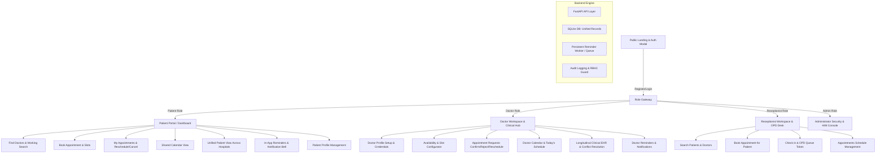

# Implementation Plan: Complete Healthcare Access Gateway Upgrade

This plan outlines the architecture, database schema, API extensions, and frontend enhancements to upgrade the Healthcare Access Gateway into a full-featured, secure, multi-hospital healthcare platform.

## 1. Architecture & Design

---

## 2. Database Schema Updates

### A. Extended `doctors` Table
Add the required profile and consultation settings:
- `languages_spoken`: VARCHAR(200) (e.g., "English, Hindi, Marathi")
- `consultation_fee`: FLOAT (default 500.0)
- `consultation_types`: VARCHAR(100) (default "IN_PERSON,ONLINE")
- `clinic_address`: VARCHAR(255)
- `city`: VARCHAR(100)
- `bio_summary`: TEXT

### B. New `doctor_availabilities` Table
Defines weekly recurring consultation hours:
- `id`: INTEGER Primary Key
- `doctor_id`: FK to `doctors.id`
- `day_of_week`: INTEGER (0=Monday, 6=Sunday)
- `start_time`: VARCHAR(10) (e.g. "09:00 AM")
- `end_time`: VARCHAR(10) (e.g. "05:00 PM")
- `slot_duration_minutes`: INTEGER (default 30)
- `consultation_type`: VARCHAR(50) (e.g., "BOTH", "IN_PERSON", "ONLINE")
- `is_active`: BOOLEAN (default True)

### C. New `doctor_blocked_periods` Table
Allows doctors to block dates/times for leave, conferences, or procedures:
- `id`: INTEGER Primary Key
- `doctor_id`: FK to `doctors.id`
- `start_datetime`: DATETIME
- `end_datetime`: DATETIME
- `reason`: VARCHAR(255)

### D. Extended `appointments` Table
- `appointment_number`: VARCHAR(50) Unique Index (e.g., "APT-2026-1001")
- `consultation_type`: VARCHAR(50) ("IN_PERSON" or "ONLINE")
- `cancellation_reason`: TEXT Nullable
- `rejection_reason`: TEXT Nullable
- `rescheduled_from_id`: INTEGER Nullable
- `patient_contact_phone`: VARCHAR(20) Nullable

### E. Extended `notifications` Table
- `appointment_id`: INTEGER Nullable FK to `appointments.id`
- `action_url`: VARCHAR(255) Nullable

### F. New `appointment_reminders` Table
Backend-scheduled persistent reminder engine:
- `id`: INTEGER Primary Key
- `appointment_id`: FK to `appointments.id`
- `recipient_user_id`: FK to `users.id`
- `reminder_type`: VARCHAR(50) ("BOOKING_CONFIRMED", "24_HOURS_BEFORE", "1_HOUR_BEFORE", "RESCHEDULED", "CANCELLED")
- `scheduled_for`: DATETIME
- `channel`: VARCHAR(30) ("IN_APP", "EMAIL", "SMS")
- `status`: VARCHAR(30) ("PENDING", "SENT", "FAILED", "CANCELLED")
- `sent_at`: DATETIME Nullable
- `error_message`: TEXT Nullable
- `created_at`: DATETIME

---

## 3. Backend API Endpoints

### 1. Authentication & Registration (`/api/auth`)
- `POST /api/auth/register`: Support patient, doctor, receptionist. Validates uniqueness, validates passwords, initializes role profile. Prevents admin self-registration.
- `POST /api/auth/login`: Issue JWT token, return user profile and role.
- `GET /api/auth/me`: Current session profile.

### 2. Doctor Profiles & Search (`/api/doctor`)
- `GET /api/doctor/search`: Query by name, specialty, hospital, city, date, consultation type. Returns doctor profiles + availability.
- `GET /api/doctor/profile`: Authenticated doctor profile.
- `PUT /api/doctor/profile`: Update doctor profile (qualifications, fee, languages, address, bio, photo).
- `GET /api/doctor/{doctor_id}/profile`: Public / patient-facing profile details.
- `GET /api/doctor/{doctor_id}/slots`: Get available appointment slots for a specific date (calculating availability minus booked appointments and blocked periods).
- `GET /api/doctor/availability`: Get current doctor's weekly schedule & blocked periods.
- `PUT /api/doctor/availability`: Update weekly working schedule.
- `POST /api/doctor/blocked-periods`: Add leave/blocked period.
- `DELETE /api/doctor/blocked-periods/{id}`: Remove blocked period.

### 3. Appointments & Booking (`/api/appointments`)
- `GET /api/appointments`: List appointments with role filtering (patients see only their own; doctors see assigned; receptionist/admin see hospital schedule).
- `POST /api/appointments`: Book appointment (allows patients, receptionists, admins). Validates slots, prevents double bookings, saves unique appointment number, triggers booking notifications & schedules 24h/1h reminders.
- `PATCH /api/appointments/{id}/status`: Transition status: `CONFIRMED`, `REJECTED`, `CHECKED_IN`, `COMPLETED`, `CANCELLED`, `RESCHEDULED`.
- `POST /api/appointments/{id}/reschedule`: Reschedule date/time, cancel old reminders, schedule new reminders, notify both doctor and patient.
- `POST /api/appointments/{id}/cancel`: Cancel appointment with reason, notify parties, cancel pending reminders.

### 4. Notifications & Reminders (`/api/notifications`)
- `GET /api/notifications`: Retrieve current user notifications (unread count + recent list).
- `POST /api/notifications/{id}/read`: Mark notification read.
- `POST /api/notifications/read-all`: Mark all read.
- `GET /api/notifications/reminders/status`: View scheduled and delivered reminders.
- `POST /api/notifications/reminders/run`: Background scheduler trigger to dispatch due reminders (also runs automatically in background).

---

## 5. Phased Execution Steps

1. **Phase 1: Backend Database & Models Migration**
   - Update `Doctor`, `Appointment`, `Notification` models.
   - Add `DoctorAvailability`, `DoctorBlockedPeriod`, `AppointmentReminder` models.
   - Update database schema safely without data loss.

2. **Phase 2: API Services & Endpoints**
   - Implement doctor search with filters & slot generator.
   - Implement appointment booking with double-booking prevention and unique identifier generation.
   - Implement appointment status management (confirm, reject, reschedule, cancel).
   - Implement reminder scheduling service & background reminder runner.

3. **Phase 3: Frontend API Client & Types**
   - Update `src/types/index.ts` with new appointment, reminder, and doctor availability types.
   - Update `src/api/client.ts` with all new endpoints.

4. **Phase 4: Patient Dashboard & Doctor Search UI**
   - Build Doctor Search & Filter component.
   - Build Appointment Booking Modal.
   - Build Patient Appointments manager with Reschedule/Cancel.
   - Integrate Shared Calendar view.

5. **Phase 5: Doctor Workspace Upgrades**
   - Build Doctor Profile Setup & Edit interface.
   - Build Availability & Working Hours manager.
   - Build Doctor Appointment Requests & Status Workflow (Confirm/Reject).
   - Integrate Doctor Calendar view.

6. **Phase 6: Shared Notifications & Reminder System**
   - Implement Notification Bell & Drawer with unread badge in Navbar.
   - Test scheduled reminders delivery.

7. **Phase 7: Verification & Testing**
   - Run backend test suite.
   - Build frontend (`npm run build`).
   - Live browser testing: Register patient, search doctor, book slot, doctor confirm, verify notifications & calendar.
